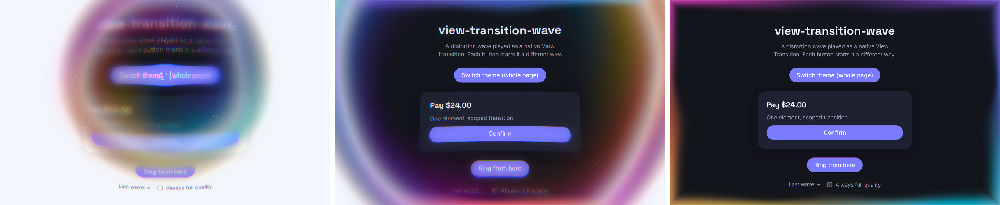

# view-transition-wave

**A shockwave page transition, played on the browser's native [View Transitions](https://developer.mozilla.org/docs/Web/API/View_Transition_API).**



Click, and the page draws in toward the pointer. Then the new state bursts out behind a front that bends the page like a lens, splits it into red, green and blue fringes, blurs it and lights it with colour. The glow lingers on the edges.

The browser takes the snapshots itself, so fonts, images, iframes, scroll positions and canvases look exactly as they are. Nothing is cloned or rasterised, and the live page is back as soon as the wave has passed.

## Credit

The idea comes from [LukyVJ's post on X](https://x.com/LukyVJ/status/2120778238196867447) and the [distortion-wave](https://github.com/LukyVj/distortion-wave) library by Lucas Bonomi. Its look and timing are distortion-wave's: this package uses its timeline directly and ports its light shader and lens profiles (MIT). distortion-wave redraws an element on a canvas; this package plays the same wave over the browser's own view-transition snapshots instead.

## Install

```sh
npm i view-transition-wave
```

## Quick start

```js
import { prepareWaveTransition, waveTransition } from 'view-transition-wave';

themeSwitch.addEventListener('click', (event) => {
  waveTransition(() => document.body.classList.toggle('dark'), { origin: event });
});

// Optional: draw the maps and compile the shaders while the page is idle, so the first wave starts at once.
requestIdleCallback(() => prepareWaveTransition({ origin: themeSwitch }));
```

`waveTransition` works like `document.startViewTransition(update)`: give it a function that changes the DOM, and it returns the transition's promises.

```js
const transition = waveTransition(update, options);
await transition.updateCallbackDone; // your update ran
await transition.ready;              // the wave is playing
await transition.interactive;        // the live page is back (the glow may still be fading)
await transition.finished;           // everything is cleaned up
transition.skipTransition();         // jump to the end
```

## Recipes

### Wave one element

```js
waveTransition(() => card.classList.add('paid'), { scope: card, origin: event, palette: 'mint' });
```

Only `card` waves. Its rounded corners and shadow are kept, and the edge glow follows its shape. The scope element must still be in the DOM after the update.

### React

As with view transitions, the DOM must be updated by the time your callback returns, so wrap state changes in `flushSync`:

```jsx
import { flushSync } from 'react-dom';

<button onClick={(event) => waveTransition(() => flushSync(() => setDark(!dark)), { origin: event })} />
```

### Start without a delay

The first wave in a scope draws and decodes its displacement maps, and the first wave on the page compiles the light's shaders. Both are kept for later waves. `prepareWaveTransition(options)` does it ahead of time, for the ring and the band in that scope, so waves from any origin there start right away. Call it once per scope you wave (for example once for the page and once for a card).

## Options

| Option | Default | |
|---|---|---|
| `origin` | the scope's centre | Where the wave starts: an element (it grows out of its box), a pointer or mouse event (a keyboard click uses the activated control), or a `{ x, y }` point in viewport px. |
| `scope` | the document | The element that transitions. |
| `shape` | `'auto'` | `'ring'` grows a circle. `'band'` sends a front off the origin's long side. `'auto'` picks a band for a box at least 1.4× longer than it is tall (or the reverse), and a ring otherwise. |
| `palette` | `'aurora'` | `'aurora'`, `'ocean'`, `'mint'`, `'ember'`, or up to 8 hex colours, blended in OKLab. |
| `duration` | from the size | Total length in ms, light included. About 2 s for a button, 4 s for a page. |
| `easing` | distortion-wave's launch | How the front travels: a CSS keyword, `'cubic-bezier(…)'`, `[x1, y1, x2, y2]` or a function. |
| `intensity` | `1` | Strength of the bending. `0` keeps only the light. |
| `particles` | `true` | `false`, or a count. |
| `quality` | `'auto'` | `'auto'` aims for 25 fps or more, dropping its costliest parts while it plays when frames come slower. `'full'` always plays everything. |
| `reducedMotion` | `'respect'` | With `prefers-reduced-motion`, `'respect'` plays the browser's plain cross-fade instead. `'ignore'` always plays the wave. |
| `types` | | View transition types, for `:active-view-transition-type()`. |
| `signal` | | An `AbortSignal`. Aborting skips the transition; the update still runs. |
| `tuning` | | Low-level knobs (`amplitude`, `lensWidth`, `aberration`, `blur`, `band`, `rimStrength`, `pull`…). See `WaveTuning` in the types. |

Other exports: `prepareWaveTransition(options)`, `isWaveTransitionSupported()` and `PALETTES`.

## Browser support

It needs same-document view transitions. Browsers without them run your update with no animation.

| Browser | What plays |
|---|---|
| Chrome, Edge 111+ | The whole wave. |
| Firefox 144+ | The reveal, the coloured light and the sparks, without the bending. Firefox draws transition snapshots on the GPU only, and through the displacement filter the bending needs, a snapshot draws nothing. |
| Safari 18+ | Untested. |

Without WebGL2, the page still bends but has no light.

## Behaviour

- **Your update always runs.** Without view transitions, it runs with no animation and `ready` rejects, as it does when a view transition is skipped.
- **It aims for 25 fps.** With `quality: 'auto'`, the wave times its own frames. If they come slower than 25 fps, it sheds the costliest part still playing: the colour split, then the blur, then the bending, then the glow's resolution. The next wave starts where this one ended, and tries one step higher after three waves in a row with frames to spare.
- **The window's edges show the page's background.** Where the wave draws the whole page in from the edges, the old background shows outside the front and the new one inside it, never black.
- **One at a time.** A new wave skips the one still playing, as a new view transition does.
- **Named elements are flattened.** While a wave plays, elements inside the scope with their own `view-transition-name` are un-named, so they bend with the scope instead of being drawn above it. Their names come back afterwards.
- **Other view transitions are left alone.** The wave's styles only apply while it plays.
- **The page takes input again at `interactive`**, about halfway through. The glow then fades over the live page.

## How it works

1. `document.startViewTransition` snapshots the scope before and after your update. While the wave plays, the scope carries the `view-transition-name` `view-transition-wave`.
2. A mask redrawn every frame shows the new snapshot inside the front and the old one outside it, through a soft seam.
3. The group holding both snapshots is drawn through one SVG filter: the inhale's pull toward the origin, a lens bulge along the front with red and blue bent by different amounts, and a blur that follows the front. Its displacement maps are drawn once on a canvas for a range of front sizes and stretched per frame. Each frame runs only the stages that move a pixel visibly.
4. A transparent WebGL2 canvas, itself a layer of the transition, draws the coloured band, the edge glow and the sparks with distortion-wave's light shader.
5. Every frame comes from distortion-wave's pure `frameState(t)`. The masks and the filter are set on the transition's pseudo-elements through held Web Animations, so only they are restyled each frame, never the page.

Limits: the front can't lean toward the touch point the way distortion-wave's does, because a snapshot's lens can only stretch along the window's axes. The blur is a single Gaussian rather than a pyramid.

## Development

```sh
npm install
npm test           # unit tests (vitest, jsdom)
npm run typecheck
npm run build      # tsdown → dist/
npm run demo       # builds, then serves the repo; open http://localhost:4321/demo/
```

## License

MIT. The light shader and the lens profiles are ported from [distortion-wave](https://github.com/LukyVj/distortion-wave) (MIT © Lucas Bonomi); see [`LICENSE`](LICENSE).
