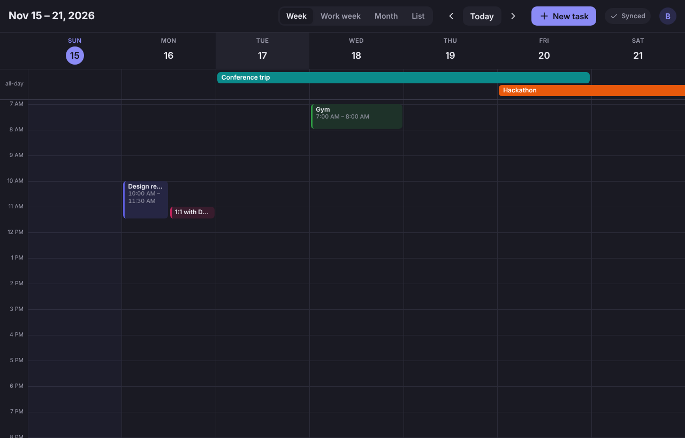
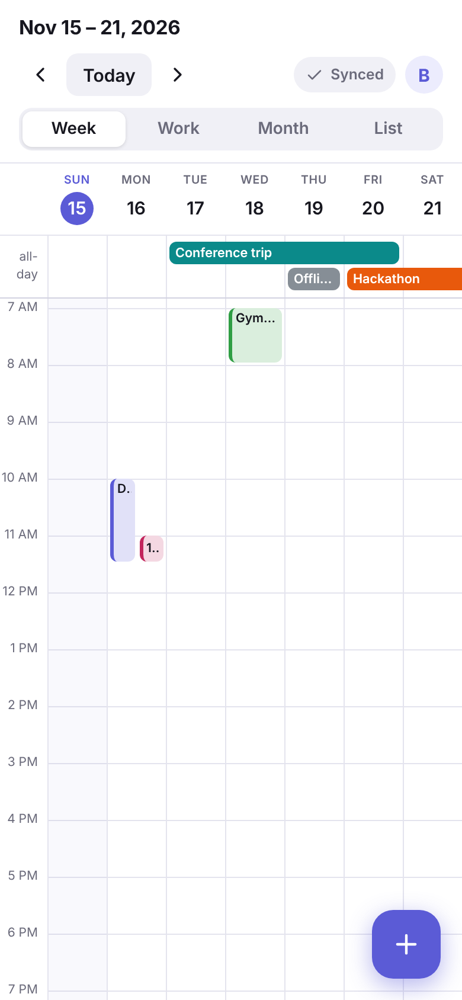

# Tasks

A local-first task calendar, built as a PWA with **React 19**, **Vite 8** (Rolldown + Oxc) and **oxlint**, synced through **Cloudflare Durable Objects** — one SQLite-backed object per user.

 

## What it does

- **Week** (Sunday–Saturday, the default), **Work week** (Sunday–Thursday), **Month** and **List** views.
- **New task** screen: title, start date, end date, an **Add time** switch (off by default) for a start and end time, and a colour.
- Click a task to edit or delete it; click an empty day or hour to start a task there.
- Multi-day tasks span the days they cover; timed tasks sit on an hour grid, side by side when they overlap.
- Keyboard: `←`/`→` page, `T` today, `N` new task, `Esc` closes the form.
- Installable, works offline, light and dark themes.

## Local first

The UI never waits on the network. Every read and write goes to **IndexedDB** on the device; the server is a sync target, not the source of the UI.

- Edits are saved locally at once and marked unsynced. A badge shows *Synced*, *Syncing*, *Offline · N unsynced* and so on.
- A background sync runs after edits, when the tab regains focus, when the network comes back, and every minute. It pushes unsynced edits and pulls anything newer than the device's cursor in one request (`POST /api/sync`).
- Conflicts are resolved per task, **last writer wins** by edit time. Deletions are tombstones, so they sync too. The server clamps timestamps from clocks running fast, so one wrong clock can't win forever.
- The service worker precaches the app shell, so the app opens with no connection at all. Signing in the first time needs a connection; after that the last user's tasks open straight from the device.
- Open tabs stay in step through a `BroadcastChannel`.
- If the session expires, local edits are kept and a dialog asks you to sign in again (you can dismiss it and keep working).
- Signing out deletes the device's copy (after warning about anything unsynced).

## Accounts and storage

Each user gets their own Durable Object, addressed by `idFromName(username)`. Its SQLite database holds:

| table | contents |
| --- | --- |
| `account` | username, PBKDF2-SHA256 password hash (100 000 iterations, random salt), failed-login counter and lockout |
| `sessions` | SHA-256 hashes of session secrets, with expiry (30 days) |
| `tasks` | the tasks, each with `updated_at`, a `deleted` flag and a server `version` used as the sync cursor |

The session cookie is `HttpOnly`, `SameSite=Strict`, `Secure` on HTTPS and scoped to `/api`. Its value is `<username>.<secret>`: the username picks the Durable Object, which checks the secret's hash. After 8 wrong passwords the account locks for 15 minutes. Writes from other origins are refused.

## Develop

```sh
cd tasks-app
npm install
npm run dev        # Vite + the Worker and Durable Object running locally in workerd
npm test           # unit tests (dates, layout, validation, sync merge)
npm run lint       # oxlint
npm run typecheck  # tsc -b over the app, the Worker and the config
npm run preview    # production build served by workerd, service worker included
```

After changing `wrangler.jsonc`, regenerate the Worker's types with `npm run types`.

## Deploy

```sh
npx wrangler login
npm run deploy     # vite build, then wrangler deploy
```

The build puts the PWA in `dist/client` (served as static assets, with SPA fallback) and the Worker in `dist/tasks_app`. Only `/api/*` runs the Worker.

## Layout

```
shared/task.ts         Task type, validation — used by the app and the Worker
worker/index.ts        routes, cookies, auth checks
worker/user-store.ts   the per-user Durable Object (SQLite)
src/data/              IndexedDB, the local store and sync engine, the merge rule
src/lib/               dates, calendar layout, a tiny router with view transitions
src/screens/           sign-in, home (views + toolbar), task form
src/views/             week / work week, month, list
scripts/icons.mjs      renders the PNG icons from public/icon.svg
```
